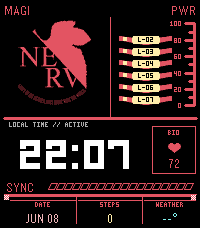

# Terminal Dogma

A NERV / Evangelion-inspired Pebble Time 2 watchface for **Emery** devices, 200×228.

The face is built as a dense MAGI-style HUD: large readable time, NERV logo block, PWR chevrons, BIO monitor, configurable lower data modules, live weather, and a slanted SYNC rail.



## Features

- Pebble Time 2 / Emery only.
- Large system-font time display using `LECO_42_NUMBERS`. In 12-hour mode the label reads `LOCAL TIME // AM` or `PM`.
- NERV logo asset and MAGI/PWR HUD framing.
- Battery: PWR chevrons plus a numeric tag in the top corner.
  - `PWR 70%` is the normal state.
  - `LOW 20%` turns yellow at 20% or less.
  - At 10% or less it becomes an inverted red plate.
  - `CHG 40%` shows while charging. `EXT 100%` shows when plugged in but not charging.
- Phone link: the `MAGI` tag becomes `LINK LOST` while the Pebble app is disconnected.
- Quiet Time: a cyan crescent moon and `QUIET` tag sits in the top bar while Quiet Time is on. It is checked every minute, so it can lag a toggle by up to a minute.
- Honest health data:
  - BIO shows the firmware's filtered heart rate. The SDK guarantees it is at most 15 minutes old.
  - BIO shows `--` when there is no reading. It never holds an old value.
  - Steps show `--` when Health data is unavailable. No placeholder numbers are shown.
- Configurable bottom modules:
  - Date | Steps | Weather
  - Date | Battery | Weather
  - Date | Steps | Battery
- Weather from Open-Meteo via the phone's location:
  - The watch keeps the last reading and its observation time, so a relaunch does not blank it.
  - After 60 minutes without an update it turns grey and is labelled `STALE`.
  - After 6 hours it shows `--°`.
- Weather unit setting: Celsius (`18°C`) or Fahrenheit (`64°F`).
- Configurable HUD accent colour: NERV red, Amber, Green, Cyan.
- Configurable SYNC rail source:
  - **Data freshness:** fills after a successful weather update and drains over 30 minutes.
  - **Steps progress:** fills toward a 10,000-step daily goal. It stays empty without Health data.
  - **Battery level:** mirrors the watch battery percentage.
  - **Aesthetic diagnostic:** fixed at 85% for pure HUD flavour.
- Transitions: **Off**, **Subtle** or **Full**, set in the settings page. Full is the default. Details are below.
- Shake to show: shake your wrist to open the heart-rate graph by default, or choose the hourly forecast in settings. The default transition is Sync Graph. Details are below.

## Shake to show

The default is **Heart rate, last 3 hours** with the **Sync Graph** transition. In settings, choose **Off**, **Weather, next 6 hours**, or **Heart rate, last 3 hours**. **Shake transition** picks **Sync Graph** or **Emergency Hex**. Upgrading from 1.0.19 moves its old Off default to Heart rate; an explicit Weather choice remains unchanged.

- **Weather.** The current temperature, the condition for this hour, the first hour with at least a 50% chance of rain (or `DRY 6H`), and six hourly bars with temperature and rain chance. Hours already past are dropped, so an older forecast shows fewer bars. The forecast follows the same freshness rules as the weather reading: `STALE` after an hour, and `NO FORECAST` once it expires at six hours.
- **Heart rate.** The current BPM as on the BIO monitor, plus 18 ten-minute averages over the last three hours from Pebble Health, with max, min, average and how many slots had a reading. Slots without a reading are gaps in the line, never filled in. With no readings at all the screen says `NO HEART RATE DATA`.
- **Sync Graph (about 1.65 s).** A ruled frame opens out of the face, phase-shifted sync waves sweep through it under the EVA 01 badge, then collapse onto the screen's own line (the heart-rate trace, or the tops of the forecast bars) before the labels type in.
- **Emergency Hex (about 1.45 s).** Red EMERGENCY hexagons cascade in from the right, with the clock, WARNING and NERV panels among them. They strobe, then drop away left to right to show the screen.
- The screen returns to the face after 10 seconds. Shake again to close it sooner. Taps in the first 1.5 seconds are ignored, because one shake fires several.
- With animations **Off**, or at 20% battery or less, the screen opens with a hard cut and no transition frames. The transition also cuts to the screen if the battery reaches critical while it plays.
- A running MAGI sequence is cancelled when the screen opens, and recoveries do not animate while it is showing.
- The accelerometer tap service is only subscribed while Shake to show is on. Health is read once when the screen opens, not every frame.

## Transitions

The transitions combine two ideas: a NERV system boot and a MAGI consensus check. Both are drawn on the original face, and both end on it.

- **Full launch sequence (about 1.8 s).** The HUD builds in stages. The time digits are visible from the first frame. The MAGI triad (BALTHASAR-2 / CASPER-3 / MELCHIOR-1) replaces the logo while three real checks resolve:
  - PWR checks the battery.
  - LINK checks the phone connection.
  - DATA checks weather freshness.

  Each check reads `PASS`, `LOW`, `LOST`, `OLD` or `NONE`. The corner tag reports the real tally (for example `MAGI 2/3`), then the logo powers back up. The sequence never waits for GPS and never claims everything is nominal when it is not.
- **MAGI-only response (about 1.25 s).** Only the logo area changes. It is used for a launch in Subtle mode, for a launch at low battery or with Quick View showing, and for a real recovery.
- **When animations play:**

  | Event | What plays |
  |---|---|
  | Face shown | Full sequence, at most once every 30 minutes. The cooldown is persisted, so closing a notification or leaving an app does not replay it. |
  | Phone link back after an outage of 1 minute or more | MAGI-only response |
  | Weather goes from missing or stale to fresh | MAGI-only response |

  - Recoveries are limited to one response per 5 minutes.
  - A routine weather refresh (fresh to fresh) never animates.
  - Nothing animates every minute. A wrist shake only opens the Shake to show screen, when that is turned on.
- **Skips and cancellation:**
  - Battery at 10% or less (not charging): nothing plays.
  - Battery at 20% or less: launch shortens to the MAGI-only response.
  - Quick View: launch shortens to the MAGI-only response, and Quick View appearing during the full sequence cancels it.
  - Changing the animation setting cancels any running sequence. Unloading the face cancels the timer.
- **Off** starts no animation timers. With Shake to show on, Off makes the shake screen a hard cut with a single 10-second timer to return.
- **Frame budget:** one 66 ms app timer while a sequence runs. Each sequence is hard-capped at a fixed number of steps.

## Repository layout

```text
package.json                  Pebble app metadata, capabilities, message keys
src/c/pebble-watchface.c      Native watchface: drawing, services, AppMessage
src/c/td_logic.[ch]           Pure decision logic (settings, weather, health/power
                              formatting, transition state machine); host-tested
src/pkjs/index.js             PebbleKit JS entry point (wires phone.js to Pebble APIs)
src/pkjs/phone.js             Weather fetch, settings page, serialised AppMessage queue
tests/run.sh                  Host tests (C logic with cc, phone logic with node)
resources/images/             NERV logo asset
emery_screenshot.png          App Store screenshot (real Emery emulator framebuffer)
CHANGELOG.md                  Release notes
docs/TESTING.md               Test and emulator-capture procedure
wscript                       Pebble SDK build config
```

## Build and test

```bash
tests/run.sh      # host tests, needs cc and node
pebble build      # writes build/<checkout-directory-name>.pbw
```

See [docs/TESTING.md](docs/TESTING.md) for emulator capture and what is not covered.

## Publish

Bump the version in `package.json` and build. Refresh `emery_screenshot.png` from a real emulator capture, then publish:

```bash
pebble publish \
  --non-interactive \
  --no-gif-all-platforms \
  --is-published \
  --release-notes 'Release notes here' \
  --screenshots emery_screenshot.png
```

Notes:

- Re-publishing the same version fails. Always bump the version first, and check the latest Store version before choosing it.
- Screenshot filenames must start with the platform name, e.g. `emery_screenshot.png`.
- `pebble publish --description` does not update the public description for an existing app. It is effectively new-app metadata. Use the dashboard for existing app description edits.

## Development notes

- Keep `MINUTE_UNIT` for the tick timer unless seconds are explicitly required.
- Use Pebble system fonts for small labels. 1×1 hand-drawn pixel text disappears in QEMU.
- Never show plausible fake data. Missing or stale values render as `--`, `STALE` or grey.
- Settings live on the watch (persist keys 1001, 1003-1009). The hourly forecast is persisted at 1014. The phone sends only values the user actually saved. If phone storage is empty, it asks the watch (`REQUEST_SETTINGS`) instead of pushing defaults.
- Message keys are append-only. The keys used up to 1.0.16 keep their order, so they keep their numeric ids.
- The UUID `44201a31-161f-4e94-ad74-24429abe073e` must not change. It is the existing Store listing.
